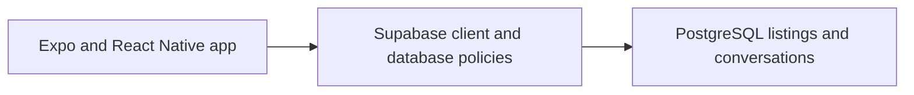

# Torrens Market

## Architecture

A three-language iPhone marketplace for buying and selling secondhand goods.

### Follow one interaction

A seller enters an item and price. The phone sends the listing to Supabase. A buyer can search, open the item and discuss a meetup. Prices and relative times are formatted in the client.

## APIs and interfaces

| Connection | What crosses it |
| --- | --- |
| Phone → Supabase | The Supabase client reads and writes listings through its data API. PostgreSQL stores the records; access policies are evaluated on the backend. |
| Supabase Auth and Realtime | Auth establishes the session on the phone. Realtime delivers changes such as new chat messages while the buyer and seller are online. |

### Why it works this way

The database decides which rows an account can access. Translations and display formatting live on the phone, so changing a label does not change the stored price or the access rules.

## Read the implementation

See [format.ts](format.ts) for how price and listing age are presented on a listing card. This source module is an excerpt from the application.

[Back to the project index](https://github.com/IT-Yun/IT-Yun)
